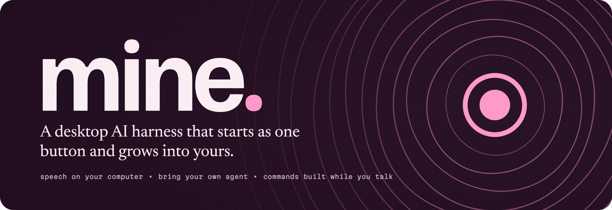

<p align="center">
  
</p>

mine is a desktop app for talking to your AI agent. When you first open it there's one button. Press it and talk, or type if you'd rather. Over time it picks up the things you do a lot and turns them into commands that run instantly, without waiting on the agent.

I'm building it for myself first. It's early and I've only run it on Windows so far, so expect rough edges.

## What it does

- **Speech stays on your computer.** Parakeet runs locally, so your voice never leaves the machine.
- **You bring the agent.** mine runs Claude Code or Pi headless, in whatever folder you point it at, using your existing subscription.
- **Simple requests skip the agent.** A fast model picks the right command from what you said and mine runs it straight away. Things like "new conversation", "show me this folder" or "open the explorer" don't need the agent at all.
- **Your agent can add to it while you talk.** It can write new commands, widgets (small HTML cards that sit in the conversation) and data collections. Nothing it writes runs until you approve it, and any change needs approving again.
- **There's a file explorer built in,** with tabs, syntax highlighting, editing and a Markdown preview.
- **The theme is up for grabs too.** Ask for a different look and the agent restyles mine while you watch.

Every feature in the app is also a command, so anything you can click you can also just say.

## What's in here

| Folder | What it is |
| --- | --- |
| [`desktop/`](desktop) | The app: Electron, React and TypeScript. Its [README](desktop/README.md) explains how it all fits together. |
| [`landing/`](landing) | The landing page: Vite and React. |

## Downloading it

Installers for Windows, macOS and Linux are on the [releases page](https://github.com/tinolaomahei/mine/releases). They aren't signed yet, so Windows will show a SmartScreen warning (More info, then Run anyway), and on a Mac you'll need to choose Open Anyway in System Settings, under Privacy & Security, the first time.

## Running it

You'll need a recent Node (I'm on 24). Claude Code or Pi needs to be installed and signed in for the agent side to work.

```
cd desktop
npm install
npm run dev
```

The landing page works the same way from `landing/`.

## Licence

MIT. See [LICENSE](LICENSE).
