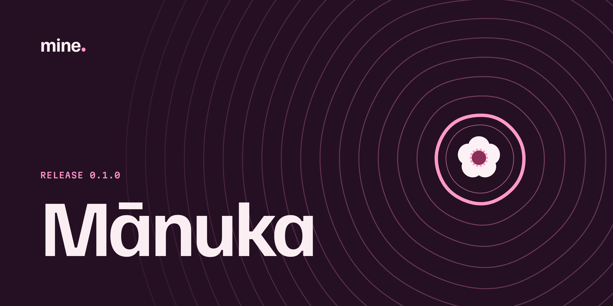

This is the first release of mine.

mine is a desktop app for talking to your AI agent. When you open it there's one button. You press it and talk, or type if you'd rather, and mine hands it to the agent you already use, signed in the way you already are. The things you do a lot turn into commands that run straight away, without waiting on the agent.

I'm building it for myself first, so it's shaped around how I work. It's early and there are rough edges, but I think it's ready for other people to have a go.

## What's in it

- mine finds the agents on your computer, like Claude Code, Codex, Gemini CLI or Pi, and runs the one you pick in the folder you choose, on the subscription you already have.
- Your voice stays on your computer. Speech is turned into text locally with Parakeet. Tap the mic or press Space, or turn on Always listening and just talk.
- If you set up instant commands, a small fast model picks the right command from what you said, so "dark mode" or "open the explorer" happens straight away. Anything you can click in mine, you can also say.
- Your agent can add to mine while you talk, with new commands and widgets. Nothing it writes runs until you approve it, and any change needs approving again.
- Screens are pages of widgets you arrange however you like. There's a marketplace with mine's own widgets and the ones your agent makes, and you can try them on sample data first.
- Tell mine what you do and which tools your team uses, and it gives you a checklist of exactly what to do to connect each one. There are 19 so far, including Jira, GitHub, Linear, Notion and Google Calendar. Your tokens are encrypted on your computer and only ever sent to that service.
- Before your agent runs a command, edits a file or fetches a page, it asks you first. You choose what it can always do, and you can take that back in Settings.
- Light or dark, a theme marketplace, or ask your agent to restyle mine while you watch.
- Settings for all of it in one place.

## Installing it

| You're on | Download |
| --- | --- |
| Windows | `mine-0.1.0-win-x64.exe` |
| A Mac with Apple silicon (M1 or newer) | `mine-0.1.0-mac-arm64.dmg` |
| A Mac with an Intel chip | `mine-0.1.0-mac-x64.dmg` |
| Linux | `.AppImage`, or the `.deb` (Debian, Ubuntu) or `.rpm` (Fedora) |

You'll need an agent installed and signed in, like Claude Code. The speech model is about 640 MB and downloads the first time you use the mic.

The installers aren't signed yet. On Windows, SmartScreen will warn you, so click More info, then Run anyway. On a Mac, macOS will block it the first time you open it, so go to System Settings, then Privacy & Security, and click Open Anyway.

`SHA256SUMS` has the checksums, and you can check where each file came from with `gh attestation verify <file> --repo tinolaomahei/mine`.

## Updates

From this version on, mine checks for new releases by itself. On Windows and Linux it downloads the update in the background and installs it next time you restart mine. On a Mac it'll let you know there's a new version and link back here, until I've sorted out signing. You can turn this off in Settings, under About.

## Rough edges

- I've mostly used it on Windows so far. It runs on Mac and Linux, but I've spent a lot less time on those.
- Signing in to Slack, Google, Microsoft, Asana, HubSpot and GitHub's MCP server needs mine registered with them first, and I haven't done that yet. Most of them have a token option in the meantime.
- The Windows and Linux builds are x64 only for now.

If you give it a go, let me know how you get on. Issues are open on GitHub.
